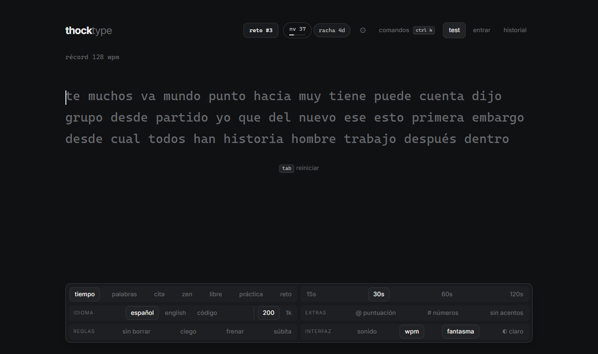
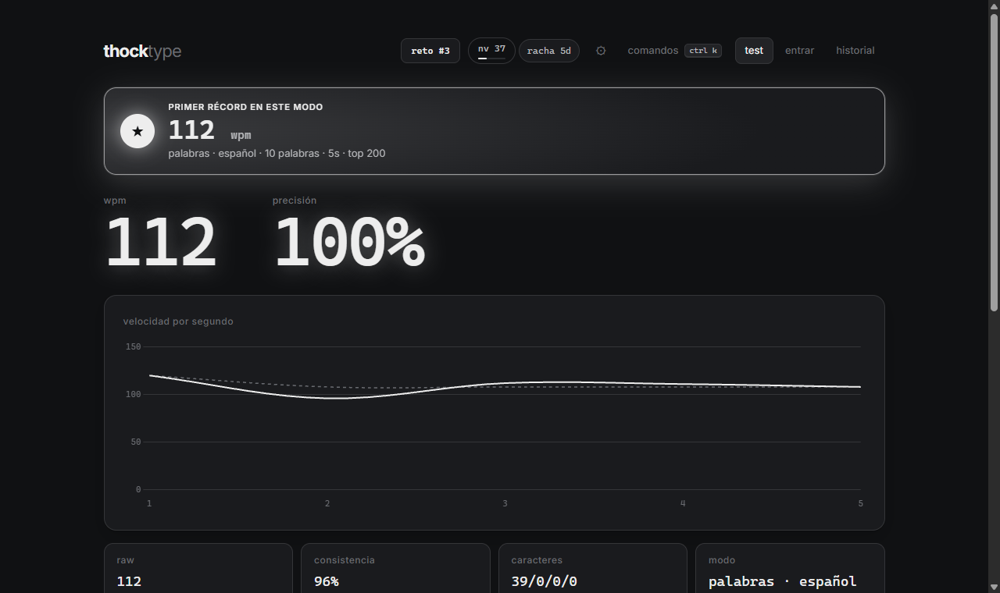
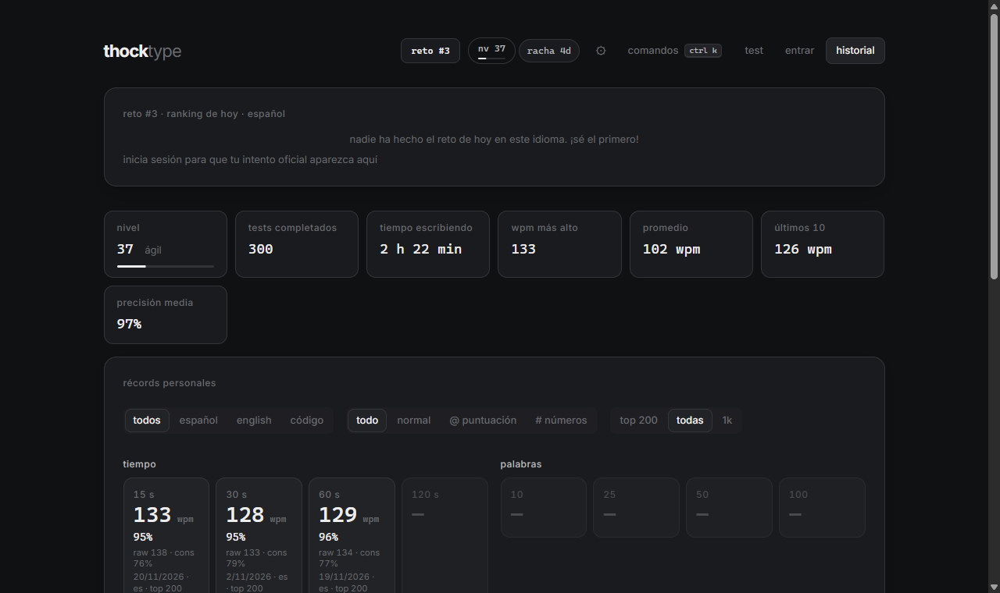
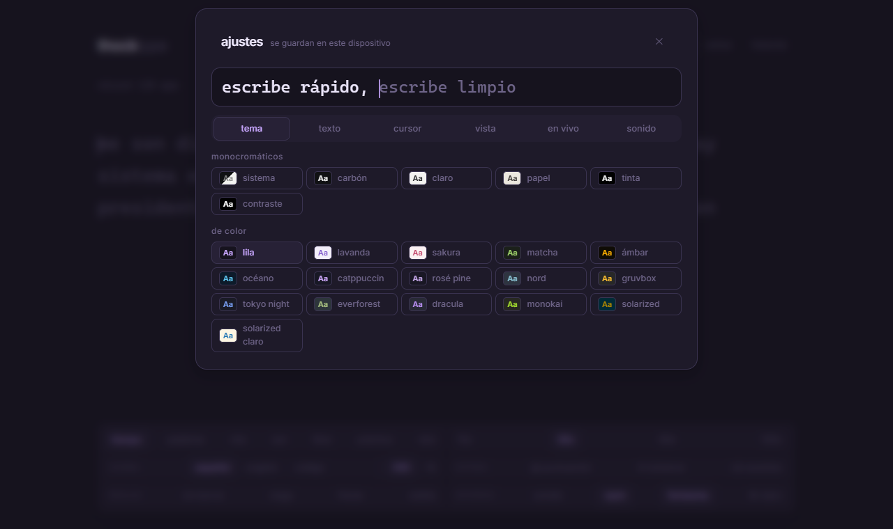

<div align="center">

# thock<sub><sup>type</sup></sub>

**Test de mecanografía minimalista, monocromático y en español.**
Escribe rápido, escribe limpio, y entiende qué te frena.

[English](README.md) · **Español**

### [→ Pruébala en thocktype.app](https://thocktype.app)



</div>

---

## Por qué ThockType

- **Hecha para el español:** listas de palabras propias, acentos y ñ, una opción **sin acentos** y citas de autores en español. También tiene inglés y código.
- **Te dice qué practicar:** el coach mide el tiempo entre cada par de letras y te muestra cuáles te frenan, por ejemplo: «*qu* es 2.1× más lenta que tu promedio». Con un clic genera un test con esas combinaciones.
- **Compites contra ti mismo, en vivo:** un cursor fantasma corre a tu récord (o a la velocidad que elijas) y el contador te dice cuántas letras le llevas.
- **Reto diario:** el mismo texto para todos, un intento oficial al día y un ranking.
- **En español e inglés:** la interfaz sale en el idioma de tu navegador y se cambia en Ajustes; el idioma de las palabras del test es independiente.
- **Sin distracciones:** blanco y negro por defecto, sin anuncios, y todo se controla desde el teclado.

## Capturas

| Resultado con récord personal | Historial y récords |
|---|---|
|  |  |

| Ajustes (tema lila) |
|---|
|  |

## Funciones

### Escribir
- **Modos:** tiempo (15/30/60/120 s), palabras (10/25/50/100), cita, **wiki** (un artículo aleatorio de Wikipedia, limpio para teclear y con su enlace), **dictado** (la app lee en voz alta y escribes lo que oyes: ortografía y acentos de oído), zen (sin límite; `shift+enter` termina), texto libre (pega el tuyo), práctica y reto diario.
- **Idiomas:** español, inglés, **português, français, deutsch, italiano, nederlands y polski**, y **17 lenguajes de programación** (JavaScript, TypeScript, Python, Java, C, C++, C#, Go, Rust, PHP, Ruby, Kotlin, Swift, SQL, HTML, CSS y Bash, más una lista mixta), cada uno con sus palabras clave, funciones y símbolos, **bloques de código reales de varias líneas** (Enter baja de línea y la sangría se pone sola, palabras clave resaltadas), y récords y ranking propios.
- **Niveles:** las **200, 1k, 5k o 10k** palabras más comunes de cada idioma, más `@ puntuación`, `# números` y **español sin acentos**, que deja la ñ.
- **Reglas combinables:**
  - *sin borrar:* no puedes usar backspace.
  - *ciego:* no ves tus errores hasta el final.
  - *frenar:* no avanzas hasta teclear la letra correcta.
  - *súbita:* un error y se acaba.
- **Funciona en celular y tablet** con el teclado táctil. Avisa si tienes **Bloq Mayús** activado.

### Entrenar
- **Coach de combinaciones:** encuentra los pares de letras que te frenan y arma una práctica con ellos.
- **Teclas débiles:** un mapa de calor del teclado por test y de todo tu historial, y un modo práctica cargado de esas letras.
- **Fantasma configurable:** puede correr a tu récord, al promedio de tus últimos 10 tests, a lo mejor de las últimas 24 h, a tu test anterior o a una velocidad fija. Mientras escribes ves *▲ 12 letras* si vas adelante o *▼ 5* si vas atrás.
- **Palabra por palabra y repetición:** al terminar ves la velocidad y los errores de cada palabra (las lentas subrayadas), lo que escribiste en realidad, puedes **repetir tu test** a 1× o 2× con tu récord corriendo al lado y practicar tus palabras más lentas en un clic.
- **En vivo:** wpm, precisión y **ráfaga** (la velocidad de tu última palabra), cada uno opcional.
- **Práctica libre:** un botón para entrenar sin que el test cuente en tu historial, tus récords ni tu nivel.

### Progreso
- **Récords personales** por modo, con wpm, precisión, raw, consistencia y fecha. Se pueden filtrar por idioma, lista y variante.
- **Celebración** cuando superas tu récord: banner, conteo de la mejora y un sonido opcional.
- **Nivel de cuenta:** cada test da XP, y hay títulos cada 10 niveles, de *novato* a *leyenda*.
- **Totales:** tests completados, tiempo escribiendo, promedio, promedio de los últimos 10 y precisión media.
- **Etiquetas:** marca tus tests ("teclado nuevo", "de noche", "cansado") y compara en el historial cuánto rindes con cada una frente a tu promedio.
- **Racha** de días seguidos, **calendario de actividad** de 6 meses y gráficas de tu evolución.

### Comunidad
- **Ranking global** en `/ranking`: 15, 30 y 60 s, por idioma y lista, de siempre o de la semana, con botón "mi lugar". El servidor decide qué resultados cuentan (duración exacta, velocidad y precisión posibles, sin tests superpuestos) y se puede excluir a tramposos desde Supabase. Quien queda en el top 10 de la semana lleva una insignia 🏆 en su perfil.
- **Duelo por link:** al terminar un test, "⚔ retar a alguien" crea un link con el mismo texto y la grabación de tu test. Quien lo abre corre contra **tu fantasma real** (con tus pausas y errores), ve en vivo cuántas letras te lleva y al final puede mandarte la revancha. Sin cuenta y sin servidor: todo viaja en el link.
- **Reto diario:** un intento oficial al día, resultado para compartir en cuadrícula ■□ y **ranking del día** con tu posición.
- **Amigos** en `/amigos`: busca gente por @usuario o nombre, agrégala con un clic (sin solicitudes que aceptar) y ve su mejor velocidad y su último test.
- **Perfiles públicos** en `/u/usuario`: foto, bio, nivel, récords, calendario y coach. Se pueden hacer privados.
- **Compartir** tu resultado como imagen o como texto.

### Personalización
Ajustes ⚙ en siete pestañas, con **buscador** (escribe "cinta" o "pitido" y te lleva a la opción). Con sesión iniciada se **guardan en tu cuenta** y te siguen a cualquier dispositivo:

| Pestaña | Opciones |
|---|---|
| **tema** | 22 temas, todos con contraste WCAG verificado por pruebas automáticas:<br>• *sistema*, que sigue el modo claro u oscuro de tu dispositivo<br>• 5 monocromáticos<br>• diseños propios: lila, lavanda, sakura, matcha, ámbar y océano<br>• Catppuccin, Rosé Pine, Nord, Gruvbox, Tokyo Night, Everforest, Dracula, Monokai y Solarized |
| **texto** | 10 fuentes (Cascadia Code es la insignia) o una **fuente instalada** en tu equipo. Además: tamaño, 2 a 4 líneas visibles y ancho |
| **cursor** | Estilo (línea, bloque, subrayado o contorno), movimiento (suave, rápido o instantáneo) y fantasma con su propio estilo |
| **vista** | **Modo cinta** (una sola línea que se desliza), resaltar la letra o la palabra, palabras escritas normales, atenuadas u ocultas, **teclado en pantalla** que marca la siguiente tecla o reacciona a lo que presionas, y cambio de línea suave |
| **en vivo** | Progreso como número, barra u oculto, qué números mostrar y su color, **modo enfoque** y gráficas desde cero |
| **sonido** | Cuatro sonidos sintetizados (thock, click, máquina y suave), volumen y **aviso de tiempo** en los últimos 5 segundos (el contador también late) |
| **perfiles** | Guarda combinaciones de ajustes con nombre (hasta 12) y cámbialas con un clic o desde `ctrl + k` |

### En cualquier lugar
- **Cuentas** con Google, un enlace por correo, o correo y contraseña.
- **Sincronización entre dispositivos:** tus tests se guardan primero en tu navegador y se suben a la nube al iniciar sesión. Sin conexión sigue funcionando y sube lo pendiente después.
- **Instalable (PWA):** después de la primera visita funciona sin internet.

## Atajos de teclado

| Tecla | Acción |
|---|---|
| `tab` / `esc` | Reiniciar o pasar al siguiente test. En el historial, `tab` navega y `esc` vuelve al test |
| `ctrl + k` (o `ctrl + shift + p`) | Paleta de comandos: modos, idiomas, reglas, temas, ajustes y más, con búsqueda que ignora acentos |
| `ctrl + backspace` | Borrar la palabra actual |
| `shift + enter` | Terminar un test zen |

## Cómo se calcula

| Métrica | Cálculo |
|---|---|
| **wpm** | Caracteres de las palabras escritas **correctamente**, incluyendo los espacios, ÷ 5 por minuto |
| **raw** | Igual que wpm, pero contando todo lo que escribiste, con errores incluidos |
| **precisión** | Teclas correctas ÷ teclas presionadas |
| **consistencia** | 100 − el coeficiente de variación de tu velocidad segundo a segundo |
| **xp** | ≈ un punto por carácter correcto + 20 por terminar el test. El reto oficial vale el doble |

## Tecnología

- **Interfaz:** [React 19](https://react.dev), TypeScript y [Vite](https://vite.dev).
- **Gráficas:** [Chart.js](https://www.chartjs.org), cargado solo cuando hace falta.
- **Animaciones coreografiadas:** [anime.js](https://animejs.com) (resultado, récord personal y logo que se teclea al abrir), cargada aparte para no pesar en la carga inicial.
- **Cuentas, datos y fotos:** [Supabase](https://supabase.com) (Postgres con Row Level Security, Auth y Storage).
- **Sin librerías de UI:** CSS propio con variables por tema. Sonidos sintetizados con Web Audio y un service worker hecho a mano.
- **Publicación:** [Vercel](https://vercel.com). Cada push a `main` se publica solo.

## Desarrollo

Requiere Node 22.18 o superior: las pruebas corren los `.ts` directamente con Node.

```bash
npm install
npm run dev     # http://localhost:5280
npm run check   # pruebas: cálculos, sincronización, niveles, rankings, traducciones y contraste de los 22 temas
npm run lint
npm run build
```

### Estructura

```
src/
  App.tsx            test, barra de opciones, resultados y atajos
  stats.ts           wpm, consistencia, récords, rachas
  words.ts           generador de palabras (listas 200/1k, sin acentos)
  coach.ts           tiempos entre pares de letras
  daily.ts           reto diario (mismo texto para todos, con semilla)
  level.ts           xp y niveles
  sync.ts            sincronización local ↔ nube
  appearance.ts      temas, fuentes y opciones visuales
  i18n.ts            idioma de la interfaz (los textos en inglés están en src/i18n/en.ts)
  SettingsPanel.tsx  ajustes en pestañas
  *.test.ts          pruebas (npm run check)
supabase/schema.sql  tablas, políticas de seguridad y almacenamiento de fotos
supabase/emails/     plantillas de los correos de la cuenta (español e inglés)
public/              íconos, manifest, service worker e imagen para compartir
```

### Tu propia base de datos

1. Crea un proyecto en [Supabase](https://supabase.com).
2. En **SQL Editor**, pega todo [`supabase/schema.sql`](supabase/schema.sql) y presiona **Run**; después haz lo mismo con [`supabase/leaderboard.sql`](supabase/leaderboard.sql) y [`supabase/friends.sql`](supabase/friends.sql).
3. En **Authentication → Providers**, activa *Email* y, si quieres, *Google*.
4. En **Authentication → URL Configuration**, agrega la dirección de tu sitio y `http://localhost:5280`.
5. En [`src/config.ts`](src/config.ts), cambia `APP_URL`, `SUPABASE_URL` y `SUPABASE_KEY`. Usa la **clave publicable**: es segura en el navegador porque cada tabla está protegida con Row Level Security. Nunca uses la clave secreta.

## Créditos

- Listas de frecuencia de **5k/10k** y de los idiomas extra: [FrequencyWords](https://github.com/hermitdave/FrequencyWords) de Hermit Dave (subtítulos de OpenSubtitles 2018), licencia [CC BY-SA 4.0](https://creativecommons.org/licenses/by-sa/4.0/). Filtradas a solo letras y sin groserías con [`scripts/buildfreq.cjs`](scripts/buildfreq.cjs); las listas derivadas en `src/data/freq/` mantienen esa licencia.
- Artículos del modo wiki: [Wikipedia](https://www.wikipedia.org), CC BY-SA, con enlace al artículo en cada test.

## Privacidad

- **Sin cuenta, nada sale de tu navegador:** tus tests, ajustes y estadísticas se guardan solo en tu navegador.
- **Con cuenta, se suben tus tests, tus estadísticas de teclas y tus ajustes** para sincronizar tus dispositivos. Tus ajustes solo los puedes leer tú.
- **Tu perfil puede ser privado:** en ese caso nadie más ve tus resultados.
- **Apoya el proyecto:** [ko-fi.com/farcode](https://ko-fi.com/farcode). ThockType es gratis y sin anuncios.
- Sin anuncios ni rastreadores entre sitios; solo un conteo de visitas anónimo y sin cookies. Las fuentes que no sean Cascadia Code se descargan de Google Fonts solo si las eliges. Detalles: [política de privacidad](https://thocktype.app/privacidad.html).

## Licencia

[MIT](LICENSE). Las listas de palabras de `src/data/freq/` mantienen su propia licencia, CC BY-SA 4.0 (ver Créditos).
