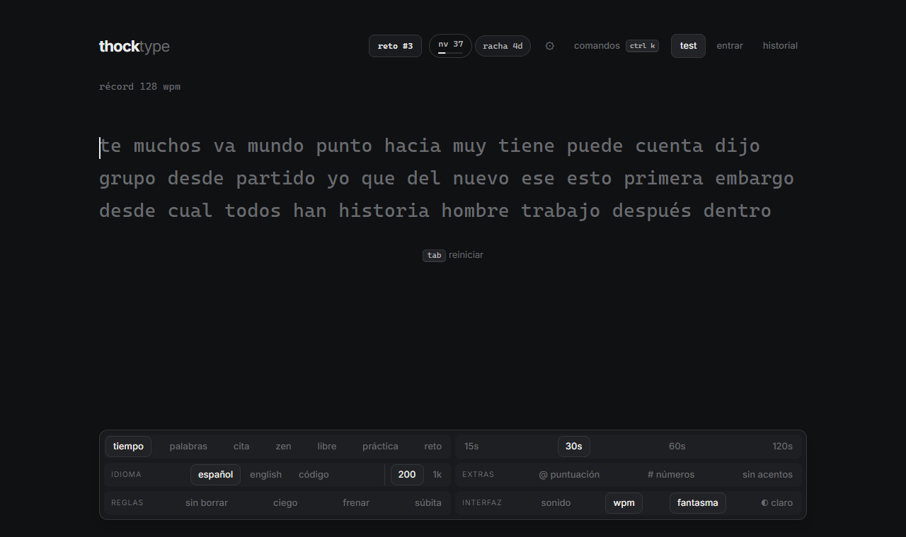
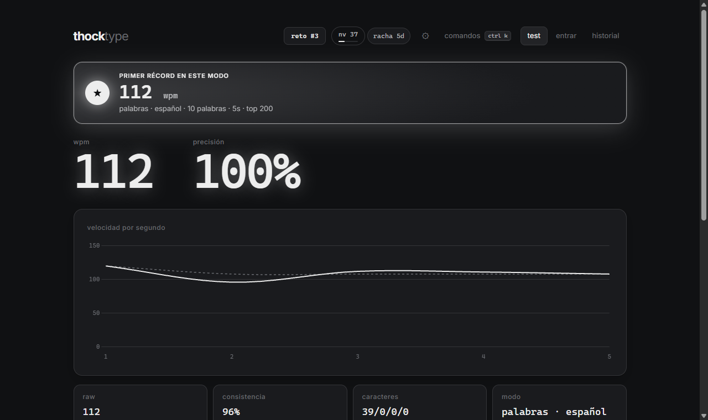
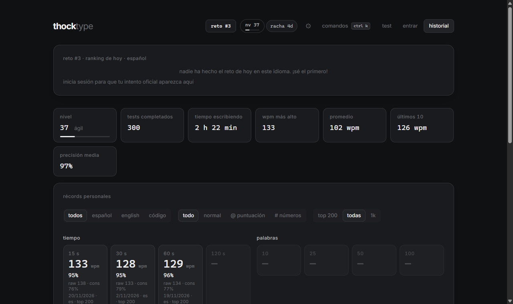
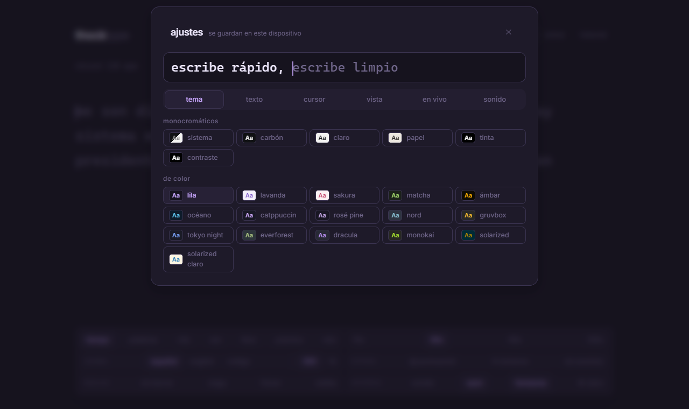

<div align="center">

# thock<sub><sup>type</sup></sub>

**A minimalist, monochrome typing test.**
Type fast, type clean, and find out what's slowing you down.

**English** · [Español](README.es.md)

### [→ Try it at thocktype.app](https://thocktype.app)



</div>

---

## Why ThockType

- **Tells you what to practice:** the coach times every pair of letters and shows the ones holding you back, like "*th* is 2.1× slower than your average". One click builds a test from those pairs.
- **Race yourself, live:** a ghost caret runs at your record (or any speed you pick) and a counter shows how many letters ahead you are.
- **Daily challenge:** the same text for everyone, one official attempt a day, and a leaderboard.
- **Many languages, done properly:** English, Spanish (with accents, ñ and an **accent-free** option), six more languages and 17 programming languages, each with its own records and leaderboard.
- **Interface in English and Spanish:** it follows your browser's language and you can switch it in Settings. The test language is separate.
- **No distractions:** black and white by default, no ads, and everything works from the keyboard.

## Screenshots

| Result with a personal best | History and records |
|---|---|
|  |  |

| Settings (lilac theme) |
|---|
|  |

## Features

### Typing
- **Modes:** time (15/30/60/120 s), words (10/25/50/100), quote, **wiki** (a random Wikipedia article, cleaned up for typing, with its link), **dictation** (the app reads aloud and you type what you hear: spelling by ear), zen (no limit; `shift+enter` ends it), custom text (paste your own), practice and the daily challenge.
- **Languages:** English, Spanish, **Português, Français, Deutsch, Italiano, Nederlands and Polski**, plus **17 programming languages** (JavaScript, TypeScript, Python, Java, C, C++, C#, Go, Rust, PHP, Ruby, Kotlin, Swift, SQL, HTML, CSS and Bash, plus a mixed list). Each has its own keywords, functions and symbols, and **real multi-line code blocks** (Enter goes to the next line, indentation fills itself in, keywords are highlighted), with their own records and leaderboard.
- **Word lists:** the **200, 1k, 5k or 10k** most common words of each language, plus `@ punctuation`, `# numbers` and **accent-free Spanish**, which keeps the ñ.
- **Rules you can combine:**
  - *no backspace:* you can't delete.
  - *blind:* you don't see your mistakes until the end.
  - *stop on error:* you can't move on until you type the right letter.
  - *sudden death:* one mistake and it's over.
- **Works on phones and tablets** with the on-screen keyboard. Warns you when **Caps Lock** is on.

### Training
- **Letter-pair coach:** finds the pairs that slow you down and builds a practice test from them.
- **Weak keys:** a keyboard heatmap for each test and for your whole history, and a practice mode loaded with those letters.
- **Configurable ghost:** it can race at your record, your last-10 average, your best of the last 24 h, your previous test or a fixed speed. While you type you see *▲ 12 letters* when ahead or *▼ 5* when behind.
- **Word by word and replay:** after the test you see the speed and errors of each word (slow ones underlined) and what you actually typed. You can **replay your test** at 1× or 2× with your record running alongside, and practice your slowest words in one click.
- **Live stats:** wpm, accuracy and **burst** (the speed of your last word), each optional.
- **Free practice:** one button to train without the test counting toward your history, records or level.

### Progress
- **Personal bests** per mode, with wpm, accuracy, raw, consistency and date, filterable by language, list and variant.
- **Celebration** when you beat your record: a banner, the improvement counting up and an optional sound.
- **Account level:** every test gives XP, with a new title every 10 levels, from *rookie* to *legend*.
- **Totals:** tests completed, time typing, average, last-10 average and mean accuracy.
- **Tags:** label your tests ("new keyboard", "late night", "tired") and compare in your history how you do with each one against your average.
- **Streak** of consecutive days, a 6-month **activity calendar** and charts of your progress.

### Community
- **Global leaderboard** at `/ranking`: 15, 30 and 60 s, per language and list, all-time or this week, with a "my place" button. The server decides which results count (exact duration, possible speed and accuracy, no overlapping tests) and cheaters can be excluded from Supabase. The weekly top 10 get a 🏆 badge on their profile.
- **Duel by link:** after a test, "⚔ challenge someone" makes a link with the same text and a recording of your test. Whoever opens it races **your real ghost** (with your pauses and mistakes), sees live how far ahead they are, and can send you a rematch. No account, no server: it all travels in the link.
- **Daily challenge:** one official attempt a day, a shareable ■□ grid result and a **daily leaderboard** with your place.
- **Friends** at `/amigos`: find people by @username or name, add them in one click (no requests to accept) and see their best speed and last test.
- **Public profiles** at `/u/username`: photo, bio, level, records, calendar and coach. They can be made private.
- **Share** your result as an image or as text.

### Customization
Settings ⚙ in seven tabs, with **search** (type "tape" or "beep" and it takes you to the option). When signed in they're **saved to your account** and follow you to any device:

| Tab | Options |
|---|---|
| **theme** | 22 themes, all with WCAG contrast checked by automated tests:<br>• *system*, which follows your device's light or dark mode<br>• 5 monochrome themes<br>• our own designs: lilac, lavender, sakura, matcha, amber and ocean<br>• Catppuccin, Rosé Pine, Nord, Gruvbox, Tokyo Night, Everforest, Dracula, Monokai and Solarized |
| **text** | 10 fonts (Cascadia Code is the signature one) or a **font installed** on your computer. Also: size, 2 to 4 visible lines and width |
| **caret** | Style (line, block, underline or outline), motion (smooth, fast or instant) and a ghost with its own style |
| **view** | **Tape mode** (a single sliding line), highlight the letter or the word, typed words normal, dimmed or hidden, an **on-screen keyboard** that marks the next key or reacts to what you press, and smooth line changes |
| **live** | Progress as a number, a bar or hidden, which numbers to show and their color, **focus mode** and charts that start at zero |
| **sound** | Four synthesized sounds (thock, click, typewriter and soft), volume and a **time warning** in the last 5 seconds (the counter pulses too) |
| **presets** | Save named combinations of settings (up to 12) and switch with one click or from `ctrl + k` |

### Anywhere
- **Accounts** with Google, an email link, or email and password.
- **Sync across devices:** tests are saved in your browser first and uploaded when you sign in. It keeps working offline and uploads what's pending later.
- **Installable (PWA):** after the first visit it works without internet.

## Keyboard shortcuts

| Key | Action |
|---|---|
| `tab` / `esc` | Restart or go to the next test. In the history, `tab` navigates and `esc` returns to the test |
| `ctrl + k` (or `ctrl + shift + p`) | Command palette: modes, languages, rules, themes, settings and more, with accent-insensitive search |
| `ctrl + backspace` | Delete the current word |
| `shift + enter` | End a zen test |

## How it's calculated

| Metric | Calculation |
|---|---|
| **wpm** | Characters of **correctly** typed words, spaces included, ÷ 5 per minute |
| **raw** | Same as wpm, but counting everything you typed, mistakes included |
| **accuracy** | Correct keystrokes ÷ keystrokes |
| **consistency** | 100 − the coefficient of variation of your second-by-second speed |
| **xp** | ≈ one point per correct character + 20 for finishing. The official daily attempt is worth double |

## Tech

- **UI:** [React 19](https://react.dev), TypeScript and [Vite](https://vite.dev).
- **Charts:** [Chart.js](https://www.chartjs.org), loaded only when needed.
- **Choreographed animations:** [anime.js](https://animejs.com) (result, personal best and a logo that types itself on load), loaded separately so it doesn't weigh on the first load.
- **Accounts, data and photos:** [Supabase](https://supabase.com) (Postgres with Row Level Security, Auth and Storage).
- **No UI libraries:** hand-written CSS with per-theme variables. Sounds synthesized with Web Audio and a hand-made service worker.
- **Hosting:** [Vercel](https://vercel.com). Every push to `main` deploys automatically.

## Development

Needs Node 22.18 or newer: the tests run the `.ts` files directly with Node.

```bash
npm install
npm run dev     # http://localhost:5280
npm run check   # tests: calculations, sync, levels, leaderboards, translations and contrast of all 22 themes
npm run lint
npm run build
```

### Structure

```
src/
  App.tsx            test, options bar, results and shortcuts
  stats.ts           wpm, consistency, records, streaks
  words.ts           word generator (200/1k lists, accent-free)
  coach.ts           letter-pair timings
  daily.ts           daily challenge (same seeded text for everyone)
  level.ts           xp and levels
  sync.ts            local ↔ cloud sync
  appearance.ts      themes, fonts and visual options
  i18n.ts            interface language (src/i18n/en.ts holds the English texts)
  SettingsPanel.tsx  tabbed settings
  *.test.ts          tests (npm run check)
supabase/schema.sql  tables, security policies and photo storage
supabase/emails/     account email templates (Spanish and English)
public/              icons, manifest, service worker and share image
```

### Your own database

1. Create a project at [Supabase](https://supabase.com).
2. In **SQL Editor**, paste all of [`supabase/schema.sql`](supabase/schema.sql) and press **Run**; then do the same with [`supabase/leaderboard.sql`](supabase/leaderboard.sql) and [`supabase/friends.sql`](supabase/friends.sql).
3. In **Authentication → Providers**, turn on *Email* and, if you want, *Google*.
4. In **Authentication → URL Configuration**, add your site's address and `http://localhost:5280`.
5. In [`src/config.ts`](src/config.ts), change `APP_URL`, `SUPABASE_URL` and `SUPABASE_KEY`. Use the **publishable key**: it's safe in the browser because every table is protected with Row Level Security. Never use the secret key.

## Credits

- **5k/10k** frequency lists and the extra languages: [FrequencyWords](https://github.com/hermitdave/FrequencyWords) by Hermit Dave (OpenSubtitles 2018 subtitles), licensed [CC BY-SA 4.0](https://creativecommons.org/licenses/by-sa/4.0/). Filtered to letters only and without profanity by [`scripts/buildfreq.cjs`](scripts/buildfreq.cjs); the derived lists in `src/data/freq/` keep that license.
- Wiki mode articles: [Wikipedia](https://www.wikipedia.org), CC BY-SA, with a link to the article on every test.

## Privacy

- **Without an account, nothing leaves your browser:** your tests, settings and stats are stored only in your browser.
- **With an account, your tests, key stats and settings are uploaded** to sync your devices. Only you can read your settings.
- **Your profile can be private:** then nobody else sees your results.
- **Support the project:** [ko-fi.com/farcode](https://ko-fi.com/farcode). ThockType is free and has no ads.
- No ads, nothing that follows you across sites, and only anonymous, cookieless visit counts. Fonts other than Cascadia Code are downloaded from Google Fonts only if you pick them. Full details: [privacy policy](https://thocktype.app/privacy.html).

## License

[MIT](LICENSE). The word lists in `src/data/freq/` keep their own license, CC BY-SA 4.0 (see Credits).
